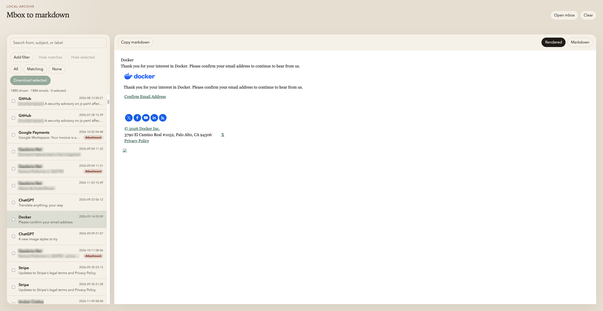

# Mbox to markdown

Turn an mbox export into Markdown in the browser. Pick the messages you want and download them, with attachments, as a zip.

The app is hosted at <https://mbox-to-markdown.lostcause.dev/>. You can also run it locally.

## Guides

- [How this app works](https://mbox-to-markdown.lostcause.dev/guides/how-it-works/)
- [Export mbox from Gmail](https://mbox-to-markdown.lostcause.dev/guides/export-gmail-mbox/)
- [What mbox is](https://mbox-to-markdown.lostcause.dev/guides/what-is-mbox/)
- [Markdown output](https://mbox-to-markdown.lostcause.dev/guides/markdown-output/)

## Use it

1. Export your mail as an mbox file. Many providers can do this. Three common ones:

   - Gmail: [Google Takeout](https://takeout.google.com/) exports Mail as an `.mbox` file.
   - Proton Mail: the Import-Export app can save folders as MBOX.
   - Apple Mail: choose Mailbox, then Export Mailbox. Open the `mbox` file inside the exported `.mbox` package.
2. Open the [hosted app](https://mbox-to-markdown.lostcause.dev/), or run it locally. You need Node.js 20 or newer for the local app.

   ```sh
   npm install
   npm run dev
   ```

   Open http://127.0.0.1:3000.
3. Open the `.mbox` or `.mbx` file in the app. The app refuses files larger than 1 GB.
4. Hide or filter the messages you do not want. Select the ones to keep, or select all.
5. Download. The result is `emails.zip`.

## What the zip contains

Each message is a Markdown file. Attachments sit next to it, grouped by month:

```text
YYYY/MM/YYYY-MM-DD-subject-slug.md
YYYY/MM/attachments/filename
```

Messages without a usable date go under `undated/`. If two messages would get the same path, the later one gets a numeric suffix. Names are shortened, and characters that break ordinary file names are removed.

A message starts with YAML front matter:

```yaml
---
type: email
subject: "Hello"
from: "Ada <ada@example.com>"
to: "Grace <grace@example.com>"
date: "2024-03-02"
time: "09:15"
labels:
  - "Inbox"
message_id: "<id@example.com>"
---
```

Empty fields are left out. Gmail labels come from the `X-Gmail-Labels` header. Attachments are linked from an Attachments section at the end of the message. If a selected message cannot be converted, the zip also includes `export-errors.txt`.

## Develop

```sh
npm test
npm run build
npm run preview
```

`npm test` runs the Node test suite. `npm run build` writes the static app to `dist/`. `npm run preview` serves that build at http://127.0.0.1:3000.

## Author

I build this alongside the other open-source projects I write about at [Lost Cause Publication](https://lostcause.dev) and list on [razvan.page](https://razvan.page).

See [CONTRIBUTING.md](CONTRIBUTING.md) to propose a change. Bug reports go to [GitHub issues](https://github.com/razvanmtn/mbox-to-markdown/issues). Security reports use [SECURITY.md](SECURITY.md).

This project is released under the [MIT license](LICENSE). Participation is covered by the [code of conduct](CODE_OF_CONDUCT.md).
